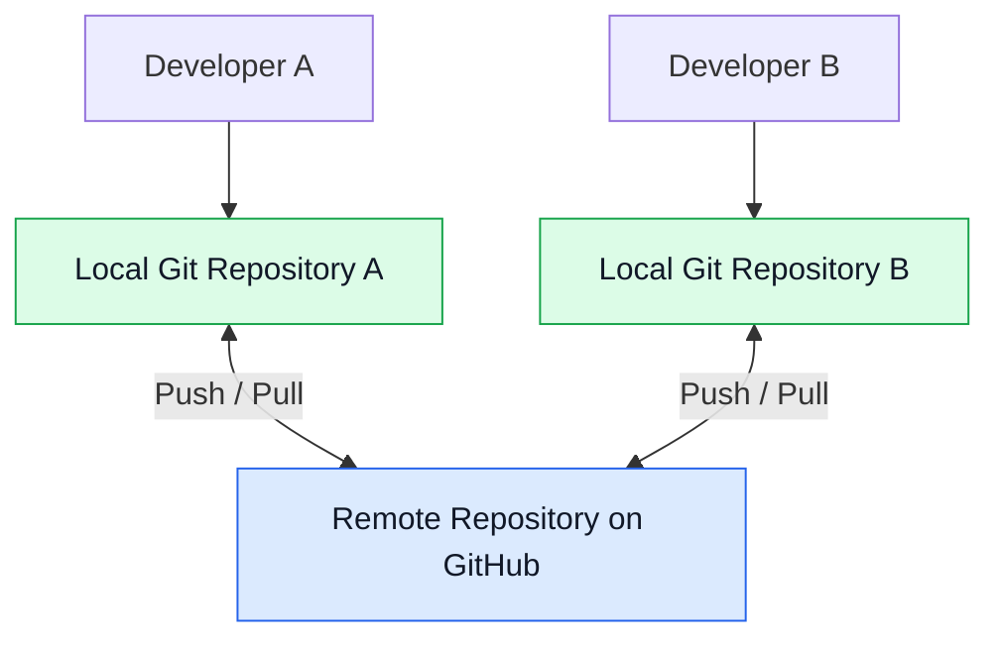
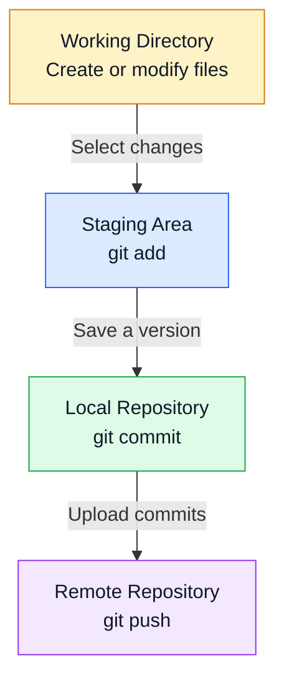
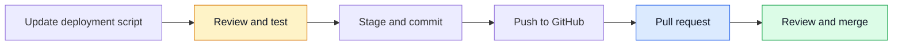

# Day 9: Git & GitHub — Study Notes

> **Learning goal:** Understand Git, GitHub, version control, the Git lifecycle, essential commands, and practical workflows.

## Git vs. GitHub


- **Git:** Tracks code changes and versions on your computer.
- **GitHub:** Hosts Git repositories online and provides collaboration tools such as pull requests, issues, and project management.

## 1. Why Do We Need Version Control?

The instructor explains two main problems:

- **Code sharing:** Two developers may work on different features of the same application. Their changes must be combined.
- **Versioning:** If a new change breaks an application, the team needs to inspect previous versions and recover the correct code.

🌱 **Plant analogy:** Imagine a plant-growing project. You record each day's changes so you can understand what changed and return to an earlier state if needed.

## 2. Centralized vs. Distributed Version Control

### Centralized — SVN


Developers depend on a central server to exchange changes. If it becomes unavailable, collaboration is disrupted.

### Distributed — Git


Developers have local repositories containing project history. They can commit locally without needing the remote server online.

**Interview answer:** Git is a distributed version control system. Each developer can maintain a local repository with project history, while remote repositories support collaboration and sharing.

### Architecture diagram



## 3. Git vs. GitHub

| Feature | Git | GitHub |
|---|---|---|
| Type | Version control software | Online hosting and collaboration platform |
| Purpose | Tracks changes and commits | Hosts repositories and supports code reviews |
| Location | Works locally | Provides remote collaboration |
| Internet | Can work without internet for local operations | Internet is generally needed for hosted collaboration |
| Dependency | Can work without GitHub | Uses Git for Git-based repositories |

**Alternatives:** GitLab and Bitbucket also provide repository hosting and collaboration features.

## 4. The Git Lifecycle



1. **Working directory:** Create or modify files.
2. **Staging area — `git add`:** Select the changes you want to include in the next commit.
3. **Local repository — `git commit`:** Save the staged changes in project history.
4. **Remote repository — `git push`:** Upload local commits to GitHub or another configured remote.

## 5. Essential Git Commands

| Command | Purpose |
|---|---|
| `git --version` | Check Git installation |
| `git init` | Initialize a repository |
| `git status` | Check current changes |
| `git add README.md` | Stage a file |
| `git diff` | Inspect unstaged changes |
| `git commit -m "Add calculator"` | Create a commit |
| `git log` | View commit history |
| `git log --oneline` | View compact commit history |
| `git push` | Upload commits to a remote |
| `git reset --hard <commit-id>` | Reset tracked files and the current branch to a commit |

> ⚠️ **Important:** `git reset --hard` can permanently discard uncommitted changes and move the current branch away from later commits. Don't use it casually on real projects.

## 6. Practice Lab — Ubuntu WSL

Run these commands in your terminal:

```bash
mkdir git-day9
cd git-day9

git init
git branch -M main

printf '# Calculator\n' > README.md

git status
git add README.md
git status

git commit -m "Initial calculator project"

echo "Addition feature" >> README.md
git diff

git add README.md
git commit -m "Add addition feature"

git log --oneline
```

### If Git asks for your identity

Configure your own name and email:

```bash
git config --global user.name "Your Name"
git config --global user.email "your-email@example.com"
```

Use the name and email you want associated with your commits. If you want GitHub to associate commits with your account, use an appropriate verified or GitHub-provided commit email.

### What did you learn?

- Initialize a local repository.
- Check the working tree with `git status`.
- Stage selected changes with `git add`.
- Inspect unstaged changes with `git diff`.
- Save versions with `git commit`.
- Review project history with `git log`.

**Remember:** You do not need GitHub for this local lab. Git works independently on your computer.

## 7. Interview Questions

<details>
<summary><strong>1. What problem does Git solve?</strong></summary>

Git tracks changes, maintains project history, and supports collaboration through repositories. It helps developers review changes and recover earlier versions.
</details>

<details>
<summary><strong>2. What is the difference between git add and git commit?</strong></summary>

- `git add` stages selected changes.
- `git commit` records the staged changes in local repository history.
</details>

<details>
<summary><strong>3. What is a fork?</strong></summary>

A fork is a separate copy of a repository on a hosting platform. It allows someone to work independently and potentially propose changes to the original project.
</details>

<details>
<summary><strong>4. Can Git work without GitHub?</strong></summary>

Yes. Git can initialize repositories, track changes, and create commits entirely on a local machine.
</details>

<details>
<summary><strong>5. What does git push do?</strong></summary>

It sends local commits to a configured remote repository, subject to permissions and branch rules.
</details>

## 8. Real-World DevOps Example

Imagine a DevOps engineer updates a shell script that deploys an application.

1. Edit the deployment script.
2. Run tests and inspect the changes using `git diff`.
3. Stage the approved changes using `git add`.
4. Record the change using `git commit`.
5. Push the commit to GitHub.
6. Open a pull request so teammates can review it before merging.



**DevOps mindset:** Version control makes changes traceable, collaboration safer, and rollbacks easier to plan. A Git commit alone does not automatically back up your code remotely; pushing is a separate step.

## Day 9 — Final Revision

- **Git =** Track and manage versions.
- **GitHub =** Host repositories and collaborate.
- **git add =** Stage changes.
- **git commit =** Save a local version.
- **git push =** Send commits to a remote.
- **git pull =** Fetch and integrate remote changes.
- **Fork =** Create a separate hosted copy of a repository.

**Next step:** Practice connecting your local repository to GitHub and pushing your first project.

IN SIMPLE WORDS AS REVESION:

## 🌱 Day 9 — Git & GitHub: Quick Notes

### 🧠 Remember in Simple Words

- **Git:** Tracks changes in your code.
- **GitHub:** Stores your Git repositories online.
- **Version control:** Keeps a history of changes.
- **Repository (Repo):** A project folder tracked by Git.
- **Staging:** Select the changes you want to save.
- **Commit:** Save a version in Git history.
- **Push:** Upload commits to GitHub.
- **Pull:** Bring remote changes into your local branch.
- **Fork:** Create your own copy of someone else's repository.
- **Branch:** Work on a separate line of development.

### ⚡ Five Commands to Remember

| Command | Simple meaning |
|---|---|
| `git init` | Start Git in a project |
| `git status` | Check what's changed |
| `git add .` | Stage changes in the current directory |
| `git commit -m "message"` | Save a version |
| `git push` | Upload commits to GitHub |

### 🔄 Easy Git Flow

**Edit → Add → Commit → Push**

🌱 Plant analogy:
- Edit = Make changes to your plant.
- Add = Select what you changed.
- Commit = Record today's progress.
- Push = Share your progress online.

### 🎯 Interview in One Minute

**Q: Why do we use Git?**

To track code changes, maintain history, and work safely with other developers.

**Q: Is GitHub the same as Git?**

No. Git tracks versions; GitHub hosts repositories and supports collaboration.

**Q: Can Git work without GitHub?**

Yes. Git can manage versions locally without an internet connection.

**Golden rule:** Git saves your history locally. Push shares your commits remotely.
